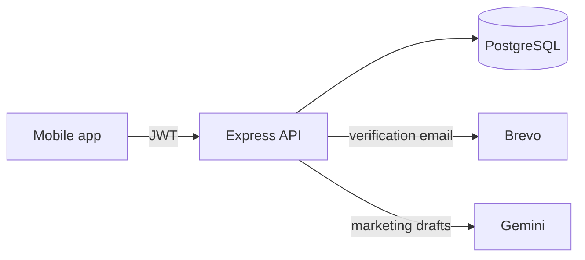

<div align="center">

# Flowly Backend

**Inventory, orders, and customer management for small businesses.**

An Express + PostgreSQL API powering a mobile seller workflow: catalog, orders, customers, and business insights in one place.


[Getting Started](#getting-started) · [API Overview](#api-overview) · [Documentation](#documentation) · [Limitations](#status-and-limitations)

</div>

---

## Overview

Flowly lets a small-business owner and their staff run day-to-day operations from a mobile app: maintain a product catalog, create customer orders, track fulfillment, and review key metrics. Owners and employees share records scoped to the business owner.

> **Project status:** Flowly Backend is an application backend in active development. It is not a hosted demo, and it makes no claim of production readiness.

## Features

| Area | What it does |
| --- | --- |
| **Accounts & staff** | Email-verified signup, JWT authentication, and owner-managed staff invitations. |
| **Inventory** | Product pricing, stock quantities, and archival of products that have sales history. |
| **Orders** | Transactional stock deductions, fulfillment statuses, and purchase-time price and cost snapshots. |
| **Customers** | Contact details, recent orders, and delivered-order statistics. |
| **Dashboard** | Revenue, profit, average order value, low-stock items, and top-selling products. |
| **AI marketing drafts** | Gemini-generated win-back and VIP messages with sent, snoozed, and dismissed states. *Drafts only: this API does not send WhatsApp messages.* |

## Architecture



**Tech stack**

| Layer | Technology |
| --- | --- |
| HTTP API | Node.js, Express 5 |
| Database | PostgreSQL, Sequelize 6 |
| Authentication | JSON Web Tokens, bcrypt |
| Verification email | Brevo REST API |
| AI drafts | Google Generative AI SDK |
| Checks | Node.js test runner, Prettier |

## Getting Started

### Prerequisites

- Node.js 22 or newer, and npm
- A PostgreSQL database that **accepts TLS connections**

> **Note:** The current database configuration requires TLS. A default local PostgreSQL installation without TLS will not connect.

### Installation

```bash
git clone https://github.com/EngYoussefElghanam/flowly-backend.git
cd flowly-backend
npm ci
cp .env.example .env
```

### Configuration

Fill in `.env` using the [configuration reference](docs/README.md#configuration).

- Set a long, random `JWT_SECRET`.
- Signup requires a Brevo API key and a verified sender.
- The Gemini key is only needed when generating new marketing drafts.

### Run

```bash
npm run dev     # development, with file watching
npm start       # standard start
```

On startup the server authenticates to PostgreSQL, runs `sequelize.sync()`, and then listens on `PORT` (default `3000`). It does not create the database itself, and startup can create missing tables, but it is not a versioned migration system.

### Verify

```bash
curl http://localhost:3000/
```

```json
{ "message": "Seller App Backend is Running!" }
```

## API Overview

Most endpoints live under `/api`; marketing lives under `/marketing`. Protected requests require:

```
Authorization: Bearer <token>
```

| Resource | Base path | Capabilities |
| --- | --- | --- |
| Authentication | `/api/signup`, `/api/login` | Owner signup, verification, staff invitations, login |
| Users | `/api/users` | List employees, delete an authorized account |
| Products | `/api/products` | Create, list, update, archive or delete |
| Customers | `/api/customers` | Create, list, details, statistics |
| Orders | `/api/orders` | Create, list, details, update status |
| Dashboard | `/api/dashboard` | Business summary |
| Settings | `/api/settings` | Read and update thresholds |
| Marketing | `/marketing` | Generate and read drafts, record actions |

The full route list, request examples, and behavioral notes are in the [API reference](docs/API.md).

## Development

```bash
npm test               # run the test suite
npm run check          # static checks
npm run format:check   # verify formatting
npm run format         # apply formatting
```

Tests cover HTTP authentication boundaries and the settings failure path, without connecting to a live database or contacting email and AI providers. They **do not** validate the full order lifecycle against PostgreSQL.

### Project structure

| Directory | Responsibility |
| --- | --- |
| `routes/` | URL registration and authentication middleware |
| `controllers/` | Request handling and business operations |
| `models/` | Sequelize models and associations |
| `middleware/` | JWT verification |
| `util/` | Database, email, and company-scope helpers |
| `test/` | Database-independent regression and HTTP tests |
| `docs/` | Setup details, API reference, and implementation notes |

## Design Notes

- **Historical profit stays accurate.** Purchase-time cost and sale-price snapshots preserve order profit even when catalog prices change.
- **Stock follows order state.** Cancelled and returned orders restore stock; reactivating them deducts it again.

## Status and Limitations

Some views intentionally use different semantics and should not be treated as reconciled financial reports:

- Dashboard totals currently include **all** order statuses.
- The customer statistics endpoint counts **delivered** orders only.
- Marketing counters are updated during order creation.

Review the [current limitations](docs/README.md#current-limitations) before using the API with real business data.

## Documentation

| Document | Contents |
| --- | --- |
| [docs/README.md](docs/README.md) | Configuration reference and current limitations |
| [docs/API.md](docs/API.md) | Every route, request examples, and important behavior |
